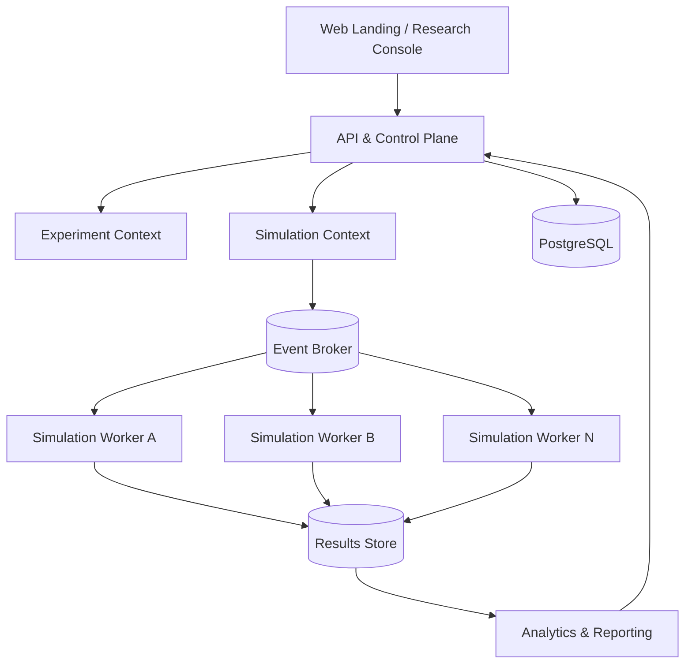

# PerfusionLab — Architecture

## Architectural principles

1. **Domain first:** organize code around bounded contexts and business capabilities, not technical layers alone.
2. **Hybrid deployment:** begin with a modular API/control-plane application and extract independently scalable workers/services only when justified.
3. **Event-driven integration:** publish facts as events; consumers own their retry, idempotency and failure handling.
4. **Compute/data separation:** simulation workers receive immutable job specifications and return versioned results. They should not own the experiment catalogue.
5. **Reproducibility:** every run records model version, input parameters, random seed (when stochastic), software version and timestamps.
6. **Safety by design:** simulated data are labeled; no patient-care recommendations or clinical alarm semantics in the MVP.

## Bounded contexts

| Context | Responsibility | Candidate deployment |
|---|---|---|
| Experiment | Experiment definitions, scenarios, provenance | Control plane |
| Simulation | Job lifecycle, orchestration, run status | Control plane |
| Physiology | Simplified mathematical models and units | Worker library/service |
| Perfusion | Circuit concepts and perfusion measurements | Worker library/service |
| Monitoring | Time-series stream and visualization | API/stream service |
| Analytics | Aggregation, comparison and exports | Analytics service |
| Identity & Audit | Authentication, authorization, traceability | Platform service |

## Logical topology

## EDA event envelope

Recommended common envelope:

- `eventId`: globally unique identifier
- `eventType`: e.g. `SimulationRequested`, `SimulationStarted`, `SimulationCompleted`, `SimulationFailed`
- `occurredAt`: UTC timestamp
- `aggregateId`: simulation/experiment identifier
- `schemaVersion`: event contract version
- `correlationId` and `causationId`
- `payload`: immutable event-specific data

**MVP status:** the API publishes `SimulationPreviewGenerated` through Spring's in-process application event mechanism and a listener records it. This establishes the domain-event seam, but it is not yet broker-backed asynchronous delivery. RabbitMQ is provisioned for local infrastructure; the next increment will add a durable event contract, broker publisher/consumer, retry policy, dead-letter queue and transactional outbox where persistence consistency requires it.

## Grid computing evolution

A simulation is a work unit, not a web request that must occupy an HTTP thread.

1. Define a versioned `SimulationJob` contract with immutable inputs and expected model version.
2. Dispatch jobs to a broker; workers pull tasks according to available CPU/memory capacity.
3. Persist job state centrally; persist large artifacts in object storage rather than broker messages.
4. Add worker registration, heartbeats, leases, timeouts and retry policies.
5. Support partitioning parameter sweeps / Monte Carlo experiments into independent tasks.
6. Add scheduler policies: queue priority, resource requirements, affinity and fair-share.
7. Scale horizontally across a server pool or cluster. Consider Kubernetes, Slurm or a dedicated scheduler only when measured workload justifies it.

The first grid-computing experiment should be an embarrassingly parallel parameter sweep, with deterministic seeds and comparison of throughput, latency and failure recovery across 1, 2, 4 and 8 workers.

## MVP deployment decision

The first increment is intentionally a **modular monolith** with clean domain boundaries and a worker-ready simulation contract. The landing page and API are separate concerns. RabbitMQ and PostgreSQL are provided in local infrastructure; the MVP does not yet persist simulation records to PostgreSQL. Extracting a broker-backed worker into a separate deployable is the next milestone, not a requirement for the first demo.

## Initial quality attributes

- Reproducibility: same input + model version yields same deterministic preview.
- Observability: correlation IDs, structured logs, health endpoints and job metrics.
- Resilience: bounded retries, idempotent consumers and dead-letter handling.
- Scalability: stateless API; horizontal worker scaling.
- Security: no real patient identifiers in the demo; secrets supplied via environment.
- Scientific integrity: units, assumptions, model version and limitations are visible.